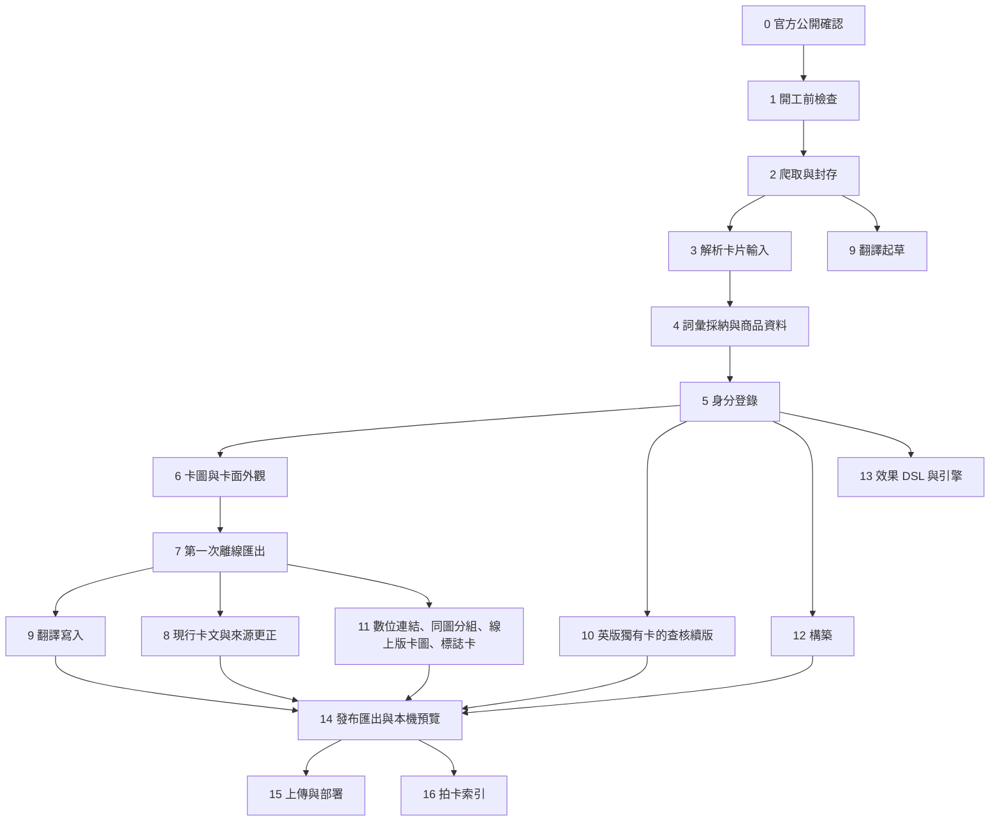

# 卡包收錄流程

官網公開新卡包後，把它收進卡表並發布到開發環境的操作順序：每一步用哪個 repo 指令、前置與產物、
哪些動作要先取得維護者同意、哪些只能由維護者執行。PR 卡追加、勘誤公告與綜合規則改版走同一套流程的子集，差異寫在後段。

本文件只寫順序與入口。欄位、驗證規則與失敗語義以各步驟連結的契約為準，兩邊不一致時以契約為準並修正本文件。
進度、排程與待決事項放 GitHub issue，不寫在這裡。用語依 [`GLOSSARY.md`](../../GLOSSARY.md)。

## 1. 共同約定

- 指令從 repo 根目錄執行，路徑參數全部寫絕對路徑。carddb 指令是 `uv --directory carddb run sve-carddb …`，
  下文省略前綴只寫 `sve-carddb …`；其他指令寫全。
- 留在 repo 外的是來源庫的位置與識別名稱、備份位置、憑證、執行配方、決定檔與草稿，範例一律用 `/private/…` 這類佔位。
  批次 ID 與來源版本是內容雜湊，會隨解析輸入與引擎測試輸入進 repo，不算私人資訊
  （[來源歸檔〈authored 的來源批次定位〉](../schema/ingest/source-archive.md#authored-的來源批次定位)）。
- 抓取 manifest 同一時間只能有一個使用者。爬取進行中不要執行 `crawl --dry-run`、`manifest check`、
  `manifest backup` 或 `archive seal`。只讀已封存批次的工作（解析輸入產生器、圖片建置、離線匯出）可以和爬取並行；
  會讀 latest cache 的工作（身分登錄的 `--images`、`images detect-stamps`）要等同範圍的卡圖階段收尾後再跑。
- 同一批公開的內容一起收：同一個卡頁批次裡的新卡包、特殊商品與 PR 卡要在同一輪處理，
  解析輸入產生器本來就要求批次內每張新卡頁都有歸檔位置。
- 資料以一般 PR 進 repo，合併前 rebase 到最新 `main` 且 CI 通過
  （[CONTRIBUTING〈CI tests and summaries〉](../../CONTRIBUTING.md#ci-tests-and-summaries)）。含官方卡文的 PR 依
  [CONTRIBUTING〈Parsed card inputs〉](../../CONTRIBUTING.md#parsed-card-inputs)在說明列出檔數、位元組數、收錄欄位與代表記錄；
  授權相關 PR 合併前交維護者確認（[AGENTS.md](../../AGENTS.md#ai-貢獻與審查)）。
- 下表「工具」欄標「人工」的步驟目前沒有 repo 指令，要依契約手寫資料或另寫一次性的本機腳本；
  收斂成單一指令的工作在 [#55](https://github.com/gbaian10/sve-kit/issues/55)。本機腳本不進 repo。

## 2. 同意、確認與執行者

| 動作                                                                | 要什麼                                                                                          | 誰執行                                 | 依據                                                                                                                                                 |
| ------------------------------------------------------------------- | ----------------------------------------------------------------------------------------------- | -------------------------------------- | ---------------------------------------------------------------------------------------------------------------------------------------------------- |
| 真實爬取，含新卡包必然發生的商品入口頁與清單頁替換                  | 每輪同意，範圍寫明地區、階段與商品；全區抓取要有全區的同意                                      | 指定的操作者                           | [受保護抓取的操作條件](../schema/ingest/refresh-operation.md)                                                                                        |
| `crawl --mode refresh`（覆寫既有 latest 原始檔）                    | 每次同意，且前置條件全部完成                                                                    | 指定的操作者                           | 同上；[來源歸檔 §4](../schema/ingest/source-archive.md#4-refresh-與中斷恢復)                                                                         |
| `crawl errata-new` 的真實抓取                                       | 每次取得同意。維護者核可清單中的每個精確公告 URL，改址須重新確認                                | 指定的操作者                           | [勘誤新增入口](../schema/ingest/refresh-operation.md#勘誤新增入口的單一-url-試跑)                                                                    |
| 取得綜合規則 PDF、重抓構築禁限來源                                  | 各自取得當次同意。規則列明地區與 PDF，禁限列明地區、入口與公告範圍                              | 指定的操作者                           | [§8](#8-綜合規則改版)；[構築採納 §1.3](../schema/domains/construction-adoption.md#13-來源重核與首發能力邊界)                                         |
| `archive acknowledge-gap`（記錄永久遺失的舊版）                     | 維護者確認首次封存前的舊內容已永久遺失、獨立備份也找不到，核對預期 hash，並明示決定記錄這個缺口 | 獲指派的操作者                         | [遺失的舊內容](../schema/ingest/refresh-operation.md#遺失的舊內容)                                                                                   |
| R2 上傳（卡圖、快照、拍卡索引）、遠端回收、任何會連到 R2 的 dry-run | 每次同意，各項分開；同意上傳不代表可以部署或回收                                                | **維護者親手執行**，agent 與 CI 不代跑 | [Cloudflare 開發環境 §7](../deployment/cloudflare-development.md#7-當次授權與上傳)                                                                   |
| 開發環境前端部署                                                    | 每次同意                                                                                        | **維護者親手執行**                     | [Cloudflare 開發環境 §5](../deployment/cloudflare-development.md#5-workers-靜態資源與-wrangler-配置)                                                 |
| 商品家族設為 `confirmed`、寫入商品身分對照                          | 維護者逐筆確認                                                                                  | 確認後由操作者寫入                     | [authored 維護方式 §10.4](../schema/domains/authored-layout.md#104-採納狀態與匯入投影)、[§11.1](../schema/domains/authored-layout.md#111-入口與封套) |
| AI 判定「措辭不同但效果相同」的現行卡文                             | 合併前維護者確認                                                                                | —                                      | [卡文版本與依據版本 §1](../schema/domains/wording-basis.md#1-比較與選用)                                                                             |
| 查核續版的「無對應」結論、同圖分組的成員、再錄版次清單              | 人工確認；模型的比對只供審閱                                                                    | 確認後由操作者寫入                     | [續版工具〈執行前提〉](../schema/domains/registry-renewal.md#執行前提)、[再錄版次](../schema/domains/authored-layout.md#再錄版次)                    |
| 推送含大量官方卡文的資料                                            | 推送前給維護者看發布清單；推到公開 repo 就等於發布                                              | —                                      | [CONTRIBUTING〈Parsed card inputs〉](../../CONTRIBUTING.md#parsed-card-inputs)                                                                       |
| 聯名作品的卡圖可以放到哪些環境，需要登入的開發環境也算              | 每輪向維護者確認，不沿用前一輪的同意                                                            | —                                      | [LICENSING.md](../../LICENSING.md)                                                                                                                   |
| 開頂層 issue、改寫 Git 歷史                                         | 每次同意                                                                                        | —                                      | —                                                                                                                                                    |

**不在可同意範圍內**：已封存的批次、版本 descriptor、收據、原始內容與其備份永久保留，圖片版本狀態也不能刪；
可以清理的只有契約列出的無引用暫存與衍生檔，以及已能從歸檔與備份驗回的 latest
（[來源歸檔 §6.1](../schema/ingest/source-archive.md#61-保留與恢復驗收)）。

其餘步驟（解析輸入、身分登錄、翻譯、卡圖建置、離線匯出、本機預覽與不連線的 dry-run）不連外也不覆寫來源，執行不必另外取得同意。
執行許可和資料採納是兩件事：資料能不能合併，仍看各契約的確認條件、獨立審核與 CI。
上表要求確認的項目，不因為兩個模型意見一致就免除。其餘判斷不了的譯名或卡圖比對先換另一個模型獨立判斷，仍拿不定才交維護者，該筆先不寫入。

## 3. 流程總覽



| #   | 步驟                                   | 前置                   | 產物                                                                                                                     | 工具                                                                                               |
| --- | -------------------------------------- | ---------------------- | ------------------------------------------------------------------------------------------------------------------------ | -------------------------------------------------------------------------------------------------- |
| 0   | 官方公開確認                           | —                      | 本輪範圍清單                                                                                                             | 人工                                                                                               |
| 1   | 開工前檢查                             | —                      | 備份根、圖片版本狀態與空間確認                                                                                           | `archive capacity`、`archive backup`、`archive restore-check`                                      |
| 2   | 爬取與封存                             | 1、同意                | 卡頁批次與卡圖批次、manifest 備份                                                                                        | `crawl`、`manifest backup`、`manifest check`                                                       |
| 3   | 解析卡片輸入                           | 2                      | `card-data/` 新檔組與批次選取                                                                                            | `parsed-cards generate`、`validate`                                                                |
| 4   | 詞彙採納與商品資料                     | 3                      | `authored/catalog/adoptions/vocabulary/`、`authored/products/`、卡包名稱 label                                           | 人工                                                                                               |
| 5   | 身分登錄                               | 3、4；卡圖階段已收尾   | `authored/registry/`、`authored/ids/`、構築名稱宣告                                                                      | `python -m sve_carddb.domains.registry`                                                            |
| 6   | 卡圖與卡面外觀                         | 5                      | 圖片索引與 WebP；主戰者卡名框、卡面標籤外觀                                                                              | `images build-index`                                                                               |
| 7   | 第一次離線匯出                         | 5、6                   | 匯出報告與建置資料庫                                                                                                     | `snapshot export-offline`                                                                          |
| 8   | 現行卡文與來源更正                     | 7                      | `authored/wording/`、`authored/registry/source-correction/`                                                              | 人工                                                                                               |
| 9   | 翻譯                                   | 起草 2；寫入 5、7      | `authored/translations/` 的卡名、風味、Q&A、效果文                                                                       | 人工；`qa-translations check`                                                                      |
| 10  | 英版獨有卡的查核續版                   | 5（日版有新卡號時）    | `authored/identity-transitions/`、新的查核輸入批次                                                                       | `registry review-jp-input`、`renew-reviews`                                                        |
| 11  | 數位連結、同圖分組、線上版卡圖、標誌卡 | 6、7                   | `authored/digital/links/`、`authored/registry/art/`、`authored/digital/art-matches/`、`authored/catalog/printing-marks/` | `digital-links candidates`、`images art-candidates`、`registry extend-art`、`images detect-stamps` |
| 12  | 構築                                   | 5                      | 禁限與構築規則採納、預設版次覆寫                                                                                         | 人工                                                                                               |
| 13  | 效果 DSL 與引擎                        | 3、5；新機制先完成引擎 | `authored/rules/author-effects/`、引擎測試輸入批次                                                                       | `author inspect`、`write`、`check`                                                                 |
| 14  | 發布匯出與本機預覽                     | 資料 PR 全部合併       | 預覽快照、構築索引、卡圖上傳描述                                                                                         | `images build-index`、`snapshot export-offline`                                                    |
| 15  | 上傳與部署                             | 14、同意               | 開發桶的卡圖與快照、開發環境前端                                                                                         | `sve-publish`、`deploy:dev`（維護者執行）                                                          |
| 16  | 拍卡索引                               | 14；上傳要同意         | `scan/` 的索引與清單                                                                                                     | `sve_scan`；`sve-publish scan upload`（維護者執行）                                                |

沒有前置又跑得久的先開：爬取、效果文起草、新機制的引擎工作。步驟 8 到 13 的比對與起草可以並行。
例外是寫入：步驟 10 的續版與步驟 11 的插畫擴組都往同一條身分轉換記錄追加分片，兩個分支各自寫入會撞同一個序號。
先合其中一支，另一支以最新的鏈尾重產，並跑它的 `--check`。

## 4. 逐步

### 步驟 0　官方公開確認

確認官網這次公開了什麼，列成本輪範圍：

- 卡表：新卡包、同批的特殊商品與 PR 卡。卡表筆數要對得上商品頁公布的種類數。
- Q&A、勘誤公告、禁限公告。
- 綜合規則版本。有改版就同輪處理（[§8](#8-綜合規則改版)），新機制的引擎工作只依規則即可先開始。
- 新出現的資料值：稀有度、卡片種類、類型、作品名、卡號字尾。任何一項都要先補採納或程式（步驟 4、[§5](#5-聯名卡包的差異)）。

### 步驟 1　開工前檢查

- **獨立備份根**：受保護抓取要求備份根在另一個裝置上，替換前會驗證舊版的收據與獨立備份
  （[收尾與容量](../schema/ingest/refresh-operation.md#收尾與容量)）。備份根是新建的時候，
  先對每個既有批次跑 `archive backup` 與 `archive restore-check`，再開始爬取。
- **空間**：用最近一個封存批次看實測大小與備份裝置的可用空間：

  ```bash
  sve-carddb archive capacity /private/archive 'sha256:<批次>' --store-id <名稱> --backup-root /private/backup/archive
  ```

  還原工作根要能容納本輪範圍的完整閉包再加餘裕，算法見同一節。

- **圖片版本狀態與轉檔快取**：圖片私有根的 `media-state.json` 是配號的唯一依據，遺失不能用 `--initial` 重建
  （[圖片索引契約](../schema/images/image-index.md#圖片建置)）。轉檔快取不在時不必全量重轉，
  步驟 6 用 `--scope` 只轉本輪的卡包。
- **CI**：確認 `main` 的 CI 正常，資料 PR 才不會卡在無關的失敗上。

### 步驟 2　爬取與封存

設定 `SVE_DATA_DIR` 與四個 `SVE_ARCHIVE_*`（[設定](../schema/ingest/refresh-operation.md#設定)）。三種狀態的行為不同：

| 四個 `SVE_ARCHIVE_*` | 預設 resume 模式真實執行時的行為                                                                                                                |
| -------------------- | ----------------------------------------------------------------------------------------------------------------------------------------------- |
| 全部提供             | 用受保護 Writer：內容改變的頁面先封存舊版再替換；收尾自動封存本次碰到的範圍、備份到獨立備份根並做還原檢查。備份根和來源庫在同一個裝置時會被拒絕 |
| 只提供一部分         | 開啟 manifest 前被拒絕                                                                                                                          |
| 都不提供             | 用一般 Writer，不覆寫內容不同的原始版本，也不封存。新卡包必改商品入口頁與清單頁，會被拒絕；下游步驟又只讀封存批次，所以收錄一律用完整配置       |

真實執行 `--mode refresh` 一律要完整配置。`--dry-run` 不寫入、不建立受保護 Writer，沒有封存配置也能跑；`--mode refresh --dry-run` 仍要給 `--set`。

```bash
sve-carddb manifest backup /private/backup/manifest/manifest-<UTC>-before.sqlite
sve-carddb crawl p0
sve-carddb crawl p1 --set <代號> --set PR --max-requests <上限>
sve-carddb crawl p2 --set <代號> --set PR --max-requests <上限>
sve-carddb crawl p5 --set <代號> --set PR --max-requests <上限>
sve-carddb manifest backup /private/backup/manifest/manifest-<UTC>-after.sqlite
sve-carddb manifest check
```

- 階段固定 `p0` → `p1`（清單各頁）→ `p2`（卡頁）→ `p5`（卡圖）；英版是 `en-p0` 到 `en-p5`。
- **範圍要和同意一致**。`p0` 沒有 `--set`：它讀商品入口，再巡每個商品清單的第一頁，是全區的發現步驟。
  `p1`、`p2`、`p5` 用可重複的 `--set <商品代號>` 限定在同意的商品；不帶 `--set` 就是全部已知商品，要有全區的同意才這樣跑。
- **預算**。`--max-requests` 是含重試與轉址的硬上限。`p0` 結束時會印出 `p1` 約需的請求數與 `p2` 的上限，照它訂。
  預算耗盡時指令印 `stopped` 並以結束碼 0 結束，不能只看結束碼。
  - `p1` 每次都從頭重讀指定商品的每一頁，最後再重讀第一頁驗證清單沒有變動。預算不夠讀完一個商品時，
    重跑也只會停在同一個地方；把商品用 `--set` 分批，並留足整份清單加一次重讀的預算。
    每個商品都印出 `<代號>: N cards on M pages` 才算完成，全部完成後才進 `p2`，否則 `p2` 會沿用舊清單。
  - `p2`、`p5` 在預設的 resume 模式會跳過已有可信副本的項目，預算耗盡後用同一個指令重跑即可接續。
- **採用批次的條件**。單筆卡頁或卡圖失敗時，指令印出該筆後繼續，最後印 `N failed` 並以結束碼 1 結束，這時可能已經印出批次 ID。
  結束碼 0、沒有 `stopped`、沒有失敗的項目，而且 `p1` 驗證過的清單卡號與卡頁列出的圖片都在批次裡，才把這個批次用到下游；
  有缺就補抓到齊再用。
- 每個有寫入的階段收尾時印出 `source archive batch: sha256:…`。`p2` 那一個是**卡頁批次**
  （解析輸入、身分登錄輸入、匯出配方的 `card_batch`），`p5` 那一個是**卡圖批次**（配方的 `image_batch`）。
- `manifest check` 的卡圖若經符號連結放在資料根之外，加 `--allow-root <目錄>`。
- 請求間隔、User-Agent 與只抓新增或變動內容的規則見 [AGENTS.md〈爬取規則〉](../../AGENTS.md#爬取規則)。

中斷後用同一個指令重跑，未收尾的提交紀錄會補做收尾。不要刪暫存檔、鎖檔或直接改資料庫；
磁碟上出現既不屬於舊版也不屬於候選新版的內容時，流程會停下並保留該檔，照
[來源歸檔 §4](../schema/ingest/source-archive.md#4-refresh-與中斷恢復) 處理。

增量爬取只抓新卡頁。既有卡頁之後才新增的 Q&A 或被官網改寫的卡文不會被抓到，
要另外對那些商品做 `--mode refresh --set …`，那是需要同意的另一件事。

### 步驟 3　解析卡片輸入

在 repo 外寫一份私有的產生請求，`sources` 指向卡頁批次，`filing` 列出批次內**每一張**新卡頁的歸檔家族，
格式見[解析輸入契約〈產生與驗收〉](../schema/ingest/parsed-card-inputs.md#產生與驗收)。

```bash
sve-carddb parsed-cards generate /private/work/request.json /private/work/card-data-candidate \
  --previous /absolute/checkout/card-data
sve-carddb parsed-cards validate /absolute/checkout/card-data --previous /private/base/card-data
```

- 產生器只寫進全新的目錄，內容是卡片檔組、批次選取與 `index.json`。`card-data/README.md` 與 `card-data/errata/`
  不在候選裡，把候選的 JSON 併回 checkout 時原樣保留，再對 checkout 跑 `validate`；`--previous` 指向 PR base 的那棵樹。
- 會變動的是 `index.json`、新的批次選取，以及有新卡號或新來源觀測的卡號區段：PR 卡補號常落在既有的區段；
  經同意重抓的既有卡頁有新 Q&A 或改寫時，原區段也會更新。先列出預期受影響的區段，其餘檔組逐位元組不變；
  舊觀測、舊批次選取與分檔位置由 `validate --previous` 把關。
- 另跑 `uv --directory carddb run pytest tests/domains/parsed_cards`，並抽幾張卡把 `documents` 與凍結頁逐欄比對。
- 產生器失敗時只印摘要，不印卡文。常見原因是 `filing` 漏列同批的 PR 卡或特殊商品。

### 步驟 4　詞彙採納與商品資料

建置遇到沒有採納記錄的原始詞彙會直接失敗，所以新的卡片種類、類型與作品名要先補：

- **詞彙**：`authored/catalog/adoptions/vocabulary/` 新增 `type`、`trait`、`title` 等採納記錄，每筆要有
  指向新卡頁的 `source_ref`，所以排在步驟 3 之後（[詞彙契約 §4.1](../schema/domains/catalog-route-adoption.md#41-詞彙與語言)）。
- **稀有度**：新的官方稀有度標籤要改程式。正規化對照與排序的權威是
  [`registry.rarity`](../../carddb/src/sve_carddb/domains/registry/rarity.py)，插入位置同時決定預設版次的選取順序
  （[詞彙契約 §7](../schema/domains/catalog-route-adoption.md#7-預設版次與稀有度)）；前端的稀有度排序、篩選與徽章同步補上。
- **商品**：`authored/products/family/<代號>/001.yaml`、`authored/products/identities/<地區>/` 的新分片
  與 `authored/translations/labels/` 的卡包名稱 label（[authored 維護方式 §10](../schema/domains/authored-layout.md#10-商品人工輸入-product-authored-v1)、
  [§11](../schema/domains/authored-layout.md#11-官方商品身分對照-product-identity-v1)、[§6.1](../schema/domains/authored-layout.md#61-卡包名稱-label)）。
  既有分片只增不改。家族的 `state: confirmed` 與每一筆商品身分對照都代表維護者實際確認過：
  先擬候選給維護者逐筆確認，確認後才寫成 `confirmed` 與正式的對照記錄。`proposed` 的家族只進診斷、不能當父列，
  建置要有 `confirmed` 的家族才會過；身分對照的候選留在 repo 外。PR 卡是歸檔集合，不建商品。
- **卡包中文名**：問維護者。
- **再錄版次**：身分登錄完成後，把另編 R 系列號的版次補進 `authored/catalog/reprints.yaml`
  （[再錄版次](../schema/domains/authored-layout.md#再錄版次)）。清單要維護者確認：要核對的是它和先前版次是同一張卡，不能只憑編號。

`authored/` 的資料不要寫等於預設值的欄位，`carddb/tests/architecture/test_authored_defaults.py` 會擋。

### 步驟 5　身分登錄

替每個新版次決定屬於哪張卡並配永久 ID。翻譯、效果、同圖分組與數位連結都掛在這個 ID 上，所以其他資料步驟都排在它後面。
配號寫入後不能重來，下面的順序不要對調。

1. **取得輸入**。依 [authored 維護方式 §3.6](../schema/domains/authored-layout.md#36-輸入保存) 建立新的永久輸入批次目錄：
   用 `sve-carddb archive extract-cards <來源庫> <卡頁批次> <輸出.jsonl> --store-id <名稱> --region jp`
   從凍結批次取得日版萃取，其餘輸入從上一個批次原樣複製。這一段沒有專用指令。
2. **看卡圖核對，定稿決定檔**，欄位見 [§3.5](../schema/domains/authored-layout.md#35-重跑與新卡包)：
   - 新的 EP／SEP 與卡面印兩個名字的聯名卡，依[同卡分組（上線前）](../schema/domains/authored-layout.md#同卡分組上線前)
     判斷是否加進 `same_cards`。已有身分轉換分片時，新的合併先交維護者決定。規則實際不同卻會被自動併在一起的用 `separate_groups` 拆開。
   - 新版次逐張和既有的[人工版次](../schema/domains/manual-printings.md#1-收錄原則)比對，分三種結果：
     確認是**不同的實體版次**（例如同一張 EP 的另一種發放），照常登錄；
     確認是**同一個實體版次**（官方後來才收錄），不能配新號，要保留原本的版次 ID 與 `int_id`、走[身分修復](../schema/domains/identity-repair.md)，
     目前沒有可直接執行的修復入口；**拿不定**的交維護者。
     後兩種只要還有一筆留在輸入裡，就**整批不要寫入**：工具會替輸入裡每一個新版次配號，沒有逐卡排除的參數。
3. **封存輸入**。決定檔定稿後才寫 `inventory.json` 與涵蓋整批的 `SHA256SUMS`，驗回副本並納入備份。之後的指令只指向這一份。
4. **寫入**。先用上一批的輸入與決定重跑 `--check` 確認零改寫，然後換成新輸入寫入，最後用同一個指令加 `--check`。

   已有身分轉換分片時，工具會拒絕非空的 `same_cards`，連 `--check` 也一樣。若前批的合併已全部寫進登錄，
   重跑改用決定檔副本，只清空已落地的 `same_cards`，保留重播仍需的來源更正與原創插畫分組。
   已併的卡依版次現有的永久卡片 ID 歸位。永久批次原檔照常保留，副本只用於驗證前批重跑零改寫。
   本批決定檔的 `same_cards` 只列仍需處理的新合併。已有轉換分片且本批的 `same_cards` 非空時，
   留存分片並在寫入前交維護者決定處理方式。

   ```bash
   uv --directory carddb run python -m sve_carddb.domains.registry \
     --jp /private/registry/<batch-id>/jp.jsonl --en /private/registry/<batch-id>/en.jsonl \
     --candidates /private/registry/<batch-id>/candidates.jsonl \
     --confirmations /private/registry/<batch-id>/confirmations.tsv \
     --original-art /private/registry/<batch-id>/original_art.jsonl \
     --decisions /private/registry/<batch-id>/decisions.json \
     --images /private/source-cache/media/images --authored /absolute/checkout/authored \
     --as-of <日版輸入日期> --renewal-inputs /private/renewal-recipe.json
   ```

   `--images` 讀的是 latest cache 的官方卡圖，決定檔裡的來源更正會用它驗圖片雜湊；同範圍的卡圖爬取要先收尾。
   登錄已有查核續版或插畫擴組的轉換記錄時才需要 `--renewal-inputs`
   （[續版工具〈歷史、建置與後續追加〉](../schema/domains/registry-renewal.md#歷史建置與後續追加)）。

5. **構築名稱宣告**。卡面印聯名名稱的版次補 `authored/catalog/adoptions/rules-names/`
   （[詞彙契約 §4.3](../schema/domains/catalog-route-adoption.md#43-特殊構築名稱)），手寫。
   舊聯名卡在新卡包再錄而名稱集合改變時，既有宣告會過期，要重新確認。

驗收：新版次數正確、各地區配號游標只往後、既有分片逐位元組不變、
`uv --directory carddb run pytest tests/domains/registry` 通過、`sve-carddb manual-printings check --authored <絕對路徑>` 通過。
登錄測試釘了各區的下一個配號，游標前進後要跟著更新。PR 說明列出併卡、分卡與再錄的判斷。

### 步驟 6　卡圖與卡面外觀

用匯出配方（欄位見步驟 7）指定新的卡圖批次，只轉本輪的卡包：

```bash
sve-carddb images build-index --inputs /private/run/recipe.json \
  --image-assets-dir /private/webp-library --image-cache-dir /private/recipe-cache \
  --image-output-dir /private/run/public --private-dir /private/image-state \
  --scope <代號> --scope <同批的其他商品> --scope PR \
  --previous-index /private/prev/image-index/<sha256>.json \
  --previous-image-upload /private/prev/image-upload/<sha256>.json \
  --previous-image-dir /private/prev/public \
  --previous-reuse-evidence /private/prev/image-reuse/<sha256>.json
```

- `--scope` 要列出**每一個**有新圖或換圖的 `home_set_id`，同批的特殊商品與 PR 都算，也可以用 `--printing-id` 逐一指定。
  漏列的新版次在上一版索引裡沒有對應的列，建置會失敗。
- 四個 `--previous-*` 的意義與拒絕條件見[指定產圖範圍](../schema/images/image-index.md#指定產圖範圍)；有人工版次時加 `--manual-image-dir`。
- 驗收對新的圖片索引與卡圖上傳描述做：本輪每個新版次的卡面都有三種尺寸的物件，範圍外的繫結、版本與內容不變，裁切診斷沒有不符。
  stdout 的寫入數與快取命中數只是執行診斷，重跑同一份輸入時寫入數可以是 0。圖片建置失敗時不能使用它寫到一半的圖。

卡面外觀要逐張看圖，沒有自動判定：

| 資料         | 位置                                                                                                    | 什麼時候要補                                                                           |
| ------------ | ------------------------------------------------------------------------------------------------------- | -------------------------------------------------------------------------------------- |
| 主戰者卡名框 | `authored/catalog/leader-name-frames.yaml`（[契約](../schema/domains/authored-layout.md#主戰者卡名框)） | 新的主戰者版次。沒寫只會顯示待確認，匯出報告沒有對應的缺項欄位，要自己列出新主戰者比對 |
| 卡面標籤外觀 | `authored/catalog/rarity-badges.yaml`（[契約](../schema/domains/authored-layout.md#卡面標籤外觀)）      | PR 卡：官方稀有度只標 PR 或「-」，等級要看卡框。缺項列在匯出報告的 `missing_pr_badges` |

標誌卡與編號卡要有同圖分組當比對參照，排在步驟 11。

### 步驟 7　第一次離線匯出

目的是拿到報告與建置資料庫，知道還缺什麼。指令與發布匯出相同，配方欄位見 [preview 建置〈建置〉](../schema/export/preview-handoff.md#建置)：

```bash
SVE_EXPORT_DIR=/private/run/export SVE_CARDDB_PRIVATE_DIR=/private/run/private \
  uv --directory carddb run sve-carddb snapshot export-offline --inputs /private/run/recipe.json \
  --bundle-dir /private/run/bundle --image-index /private/image-state/image-index/<sha256>.json
```

前置條件：

- 配方的 `revision` 是含身分登錄與商品資料的 commit，本機分支已提交即可，不必等合併。缺商品資料時建置會因找不到家族而失敗。
- 配方從上一版複製後改 `repo`、`revision`、`data_version`、`published_at`、`as_of`；`construction` 用當下版本的設定，舊值可能缺新加的來源。
- 批次依地區與來源種類各自改釘本輪驗證過的：卡頁有變動的地區改 `card_batch`；有新圖或換圖才改 `image_batch`。
  只有卡頁變動時，例如只重抓既有卡的 Q&A，核對原卡圖批次仍完整涵蓋本次引用的圖片後，沿用原 `image_batch`。
  圖片索引所釘的卡圖批次要和匯出配方一致。
- 一律明示 `SVE_EXPORT_DIR` 與 `SVE_CARDDB_PRIVATE_DIR`。環境已有同名變數時，輸出會寫到非預期的匯出根。
- 有來源更正時必須給 `--image-index`，而且索引要含該卡圖的證據；所以先做步驟 6。

報告在私有根的 `reports/<manifest-hash>.json`，bundle 內也有一份，連同建置資料庫。主要欄位：

| 欄位                                                                      | 內容                                   | 後續步驟                                                  |
| ------------------------------------------------------------------------- | -------------------------------------- | --------------------------------------------------------- |
| `effect_translations`                                                     | `owner_fields` 有逐欄明細與退回原因    | 步驟 9 的效果文缺譯清單                                   |
| `flavor_translations`、`qa_translations`                                  | 只有筆數（條目、已套用、未使用或過期） | 步驟 9：缺哪幾筆要拿本批的日文來源和已套用的譯文比對      |
| `pending_face_regions`                                                    | 表記未定的卡面與地區組合數，只有總數   | 步驟 8：是哪些卡面，查 bundle 建置資料庫的 `face_wording` |
| `excluded_printings`                                                      | 被排除的版次與原因                     | 新版次不該出現在這裡                                      |
| `missing_pr_badges`                                                       | 缺卡面標籤外觀的 PR 版次               | 步驟 6                                                    |
| `rarity_diagnostics`、`product_diagnostics`、`product_family_diagnostics` | 沒有代碼的稀有度、對不上的商品         | 步驟 4                                                    |
| `registry_reviews`（含 `uncovered_jp_card_numbers`）                      | 查核範圍沒涵蓋到的日版卡號             | 步驟 10                                                   |
| `digital_links`、`digital_art`                                            | 有效與過期的數位連結、卡圖狀態         | 步驟 11                                                   |
| `rules_name_adoptions`、`default_printing_overrides`                      | 構築名稱宣告與預設版次覆寫的套用結果   | 步驟 5、步驟 12                                           |

舊卡多了新版次而原本的卡文判定過期時，匯出會直接以 `Stale wording decision` 失敗，沒有報告可讀：先照步驟 8 重判那張卡，再重跑。

匯出很久也很吃記憶體。用 [`carddb/docker/export.sh`](../schema/export/preview-handoff.md#docker-與效能量測) 可以設 CPU 與記憶體上限；
在有單一指令時限的執行環境裡，改成背景服務執行再等待結果，否則會被中途終止。

### 步驟 8　現行卡文與來源更正

表記未定的卡面依[卡文版本與依據版本契約](../schema/domains/wording-basis.md#2-判定輸入)判定後寫 `authored/wording/<代號>/`。
機械規則能判定等價的（只差空白、句子標點與已識別關鍵字的括號提醒）不必寫判定。其餘差異逐項寫理由與分類；
AI 的判定標 `method: ai`，只是供審閱的依據，合併前要維護者確認，只有維護者確實判定的才記 `manual`。
每筆判定釘著當時的比較雜湊，卡面多了新觀測就要重審並重算。

官網漏字或疑似誤植先看卡圖。卡圖能證明時寫來源更正
`authored/registry/source-correction/`（[authored 維護方式 §3.4](../schema/domains/authored-layout.md#34-來源更正)），
理由只寫事實：官網缺什麼、卡圖印了什麼、補回什麼。

### 步驟 9　翻譯

繁中一律以日文為來源，原則與顯示規則見[翻譯契約](../schema/domains/translation-contract.md)與[翻譯維護流程](../schema/domains/translation-policy.md)。
起草在爬取完成後就可以開始；寫入要等永久 ID（步驟 5）與第一次匯出的結果（步驟 7）。

| 內容       | 位置                                                                                         | 契約與檢查                                                                                                        |
| ---------- | -------------------------------------------------------------------------------------------- | ----------------------------------------------------------------------------------------------------------------- |
| 卡名、專名 | `authored/translations/glossary/`                                                            | [術語採納](../schema/domains/glossary-adoption.md)                                                                |
| 風味文字   | `authored/translations/flavor/`                                                              | [風味對照表](../schema/domains/flavor-translation.md)                                                             |
| Q&A        | `authored/translations/qa/<代號>.yaml`                                                       | [Q&A 直接譯文](../schema/domains/qa-translation.md)；`sve-carddb qa-translations check --authored … --database …` |
| 效果文     | `authored/translations/semantic-definitions/`、`templates/definitions/`、`templates/values/` | [四層翻譯共用契約](../schema/domains/four-layer-translation.md)                                                   |

- 起草與寫入沒有 repo 指令。效果文的做法是：從報告的 `owner_fields` 取未匹配的欄位，與既有句框架的角色、原文與葉槽完全相同的直接沿用，
  其餘新起草，再重跑匯出確認。
- **譯文回歸必須為零**：比較寫入前後兩次匯出，既有已譯欄位的全文與 `low_confidence` 逐欄相同。
  寫入前先用最新 `main` 重跑一次匯出，只補真正缺的，否則會重複插入 `main` 已有的句框架。
- 驗證翻譯資料要用正式 loader 讀實際分片；只跑合成資料的測試抓不到排序與來源欄位的驗證錯誤。
- 句框架救不了的欄位是來源分類的問題，要改程式或補登錄：新關鍵字要先登錄
  （[關鍵字登錄與機制投影](../schema/domains/keyword-mechanics.md)），新的數值寫法要補辨識規則
  （[模板參數辨識規則](../schema/domains/template-parameter-policy.md)）。這類欄位列出來另開 PR，不要為了過檢查改譯文。
- 新作品的角色名與用語先查同作品的官方中文資料；查不到的整理成清單，一次給維護者確認。
- Q&A 的新題號應該從上次最大題號的下一號開始連續。沒有檢查工具，從解析輸入的前後差異自己核對有沒有新的缺號。

### 步驟 10　英版獨有卡的查核續版

只在**日版有新卡號**時做。既有的英版獨有卡各有一筆「日版無對應」的查核，範圍釘在當時的日版全集；
日版新增卡號後，這些查核要對新的全集重審，否則建置回報 `review_scope_outdated`，英版獨有卡的顯示特例退回原文。
工具與輸入格式見[查核續版工具](../schema/domains/registry-renewal.md#confirmed_none-續版)。

1. 拿本輪的日版新卡和既有的英版獨有卡比對：職業、種類、數值、類型、卡名意義與效果。比對沒有工具；模型的比對只供審閱，
   「仍無日版對應」的結論要人工確認後才能寫進決策。發現其實是同一張卡時不是續版，要走完整的身分採納流程。
2. 身分登錄的 PR 合併後，先更新續版配方：`repo` 與 `program_revision` 指向含本輪登錄的 `main` commit
   （釘分支上的中間 commit，squash 合併後就無法重建），`sources` 的日版 `card_batch` 改成本輪的卡頁批次；`registry_review_inputs` 先不動。
   再匯出目前全部已登錄日版版次的輸入，核對卡號集合等於登錄的完整日版集合：

   ```bash
   sve-carddb registry review-jp-input --inputs /private/renewal-recipe.json --output /private/registry/<新批次>/jp.jsonl
   ```

3. 用它建立新的永久輸入批次（`inventory.json`、`SHA256SUMS`、備份），建好後才把續版配方的 `registry_review_inputs` 改釘這個新批次，
   並寫好明示的決策 JSON。
4. 先不帶旗標看計畫，再寫入並檢查。寫入要和步驟 11 的插畫擴組排好先後（見 [§3](#3-流程總覽)）：

   ```bash
   sve-carddb registry renew-reviews --inputs /private/renewal-recipe.json --decisions /private/review-decisions.json
   sve-carddb registry renew-reviews --inputs /private/renewal-recipe.json --decisions /private/review-decisions.json --write
   sve-carddb registry renew-reviews --inputs /private/renewal-recipe.json --decisions /private/review-decisions.json --check
   ```

5. 匯出配方的 `registry_review_inputs` 同步改釘新批次。

英版新卡包不用這兩個指令，見 [§9](#9-英版新卡包的差異)。

### 步驟 11　數位連結、同圖分組、線上版卡圖、標誌卡

有先後：新增數位連結會讓線上版卡圖的舊記錄退回未知，標誌偵測要用同圖分組當參照。

1. **數位連結**。`sve-carddb digital-links candidates` 不會自己找候選，它重播一份私人研究草稿並做機械分層
   （[數位對應採納 §8.1](../schema/domains/digital-link-adoption.md#81-候選工具)）：先從本輪新卡與凍結的數位版資料整理出草稿與建置 context，
   再交給指令。報告不是採納。逐組看圖確認後手寫 `authored/digital/links/<代號>/` 並更新 `index.yaml`，
   審閱層級照實填，模型審過的不寫成人工確認。沒有同名候選的卡保持未知。
2. **同圖分組**。對完整圖片索引產生候選，有上一次的候選檔時加 `--previous`（[插畫同圖候選](../schema/images/art-candidates.md)）：

   ```bash
   uv --directory carddb run --extra art-matching sve-carddb images art-candidates \
     --image-index /private/image-state/image-index/<sha256>.json --image-root /private/run/public \
     --authored /absolute/checkout/authored --output /private/work/art-candidates.json
   ```

   分數落在灰區的逐對看圖；同圖的結論要人工確認，工具不推定。新組手寫進 `authored/registry/art/<代號>/`；新版次加入既有組用
   `sve-carddb registry extend-art --inputs … --decisions … --write`（[既有 art 擴組](../schema/domains/registry-renewal.md#既有-art-擴組)）。

3. **線上版卡圖**。依[線上版卡圖採納](../schema/domains/digital-art-matches.md)的固定 recipe 比對，寫
   `authored/digital/art-matches/<代號>/`，並把新分片的路徑列進上一層 `authored/digital/art-matches/index.yaml` 的 `includes`，漏列會被 loader 拒絕。
   產生分片的程式不在 repo；灰區由人裁決並記在 `manual_review`。
   前端的「SVE 專屬」篩選讀這份資料：沒有同卡數位連結的卡本來就算專屬；有連結的卡要每個數位版遊戲的卡圖狀態都確認為找不到才算。
   所以新卡加了連結卻沒做這一步，就不會出現在篩選結果裡。
4. **標誌卡與編號卡**（PR 卡）。同圖登錄完成後才跑，工具才有比對參照；沒有參照時只剩金色區域偵測，會漏掉銀色或彩色的標誌：

   ```bash
   uv --directory carddb run --extra art-matching sve-carddb images detect-stamps \
     --scope pr --authored /absolute/checkout/authored --parsed-cards /absolute/checkout/card-data \
     --data-dir /private/source-cache --output /private/work/stamp-review --unreviewed-only
   ```

   候選切圖要人看過才寫入 `authored/catalog/printing-marks/`；沒有候選不代表沒有標誌，仍要看來源圖
   （[新增 PR 卡後的檢查](../schema/domains/printing-marks.md#新增-pr-卡後的檢查)）。

### 步驟 12　構築

- **禁限重核**：每次出新卡包重抓入口與公告並重核（[構築採納 §1.3](../schema/domains/construction-adoption.md#13-來源重核與首發能力邊界)）。
  抓取要當次授權；新的來源要加進匯出配方的 `construction`。
- **作品專屬的構築條件**：綜合規則為新作品定了專屬條件時要改程式
  （[牌組構築 §3.3](../sim/deck-construction.md#33-作品名自己的構築條件14)）。
- **預設版次覆寫**：新版次成為既有覆寫的新候選時，覆寫會過期；看報告的 `default_printing_overrides`，
  重新確認後更新 `authored/catalog/overrides/defaults/`（[詞彙契約 §5](../schema/domains/catalog-route-adoption.md#5-同號路由與預設版次覆寫)）。

### 步驟 13　效果 DSL 與引擎

1. 新機制先做引擎與 DSL 語法，只依綜合規則，不必等卡表。
2. 動手寫卡之前先掃一遍全部新卡，找出共同缺的積木。共用積木的 PR 先合，卡片批次後開。
3. 更新 [`tests/engine/card-input.json`](../../tests/engine/README.md) 中本次效果工作所用的已審卡頁批次。
   日版用 `batch_id`，英版獨有卡用 `en_batch_id`。測試投影保留整批日版及已確認無日版版次的英版卡。
4. 逐卡用[效果作者工具](../dsl/authoring-tools.md#寫入與驗證)寫入：

   ```bash
   sve-carddb author inspect --inputs /private/work/public.json --card <卡號> --output /private/work/inspect.json
   sve-carddb author write --inputs /private/work/public.json --main /private/work/main.yaml \
     --output-root /absolute/checkout/authored --card <卡號>
   sve-carddb author check --inputs /private/work/public.json --output /private/work/check.json
   ```

   每張新卡都要有主檔；沒有對局能力的卡寫 `abilities: []`。

5. 對局行為測試放 `sim/engine/tests/current_repository/runtime/`，一個檔一組，建置腳本會自動探索。

多人並行時，卡片 PR 都會改到同一批共用檔（`effects-index/<代號>.yaml`、測試入口、
`.github/ci/snapshot-format.lock`），逐支合併會連環衝突。同時有多支已審過的這類 PR 時，併成一支批次 PR，
只重審整合的部分；測試共用的 fixture 模組集中宣告一次，不要每支 PR 各自宣告。

DSL 不擋卡表發布。還沒寫的卡在建置裡是缺 DSL：查卡、卡文、翻譯與直接讀卡文的印刷機制篩選不受影響，
受影響的是模擬器與其他需要效果實作的功能。

### 步驟 14　發布匯出與本機預覽

資料 PR 全部合併後，用最新的 `main` 做一次完整匯出。目前只支援開發桶的預覽快照
（[快照匯出流程](../schema/export/snapshot-export.md)）。

1. 配方的 `revision` 改成 `main` 的 commit，批次照步驟 7 的規則改釘；做過步驟 10 的話 `registry_review_inputs` 也要改。
2. `images build-index` 跑全量：`--scope`、`--printing-id` 與四個 `--previous-*` 全部拿掉（範圍參數和 `--previous-*` 必須同時出現或同時不出現），
   用正式的圖片私有根、WebP 庫與轉檔快取。範圍建置不會回填範圍外的轉檔快取，所以快取曾經遺失時，第一次全量建置會重轉舊圖。
   這次的索引也會包含來源更正需要的卡圖證據。
3. `snapshot export-offline --brotli`，釘住上一步的圖片索引。構築索引隨匯出一併產生，缺了就不能發布。
   輸出報告若註明 `construction_index: skipped`，先看原因：快照缺判斷所需的事實時，補產指令同樣會失敗，要修正輸入後重新匯出；
   只有既有匯出根單純缺檔，才用 `sve-carddb snapshot construction-index --export-dir <匯出根>` 補產
   （[構築索引 §1](../schema/export/construction-index.md#1-產出)）。
4. 看報告：新卡包的版次全部在快照裡、`excluded_printings` 沒有新版次、譯文回歸為零。
   容量照[容量與記憶體預算](../schema/export/size-budget.md)；卡包特別大時，單一家族的文字檔可能超過門檻，
   要調整該卡包的文字分段設定（`carddb/src/sve_carddb/contracts/profiles.py` 的 `text_bands` 與前端 `sim/web/src/data/locator.ts`
   的對應清單要一起改），前端要跟著部署。
5. 離線對帳：不帶範圍的 `sve-publish images upload --dry-run` 與 `sve-publish snapshot upload --dry-run` 完全離線，不讀憑證
   （[Cloudflare 開發環境 §6](../deployment/cloudflare-development.md#6-分開的卡圖與快照離線對帳)）。
   帶 `--scope` 的卡圖 dry-run 要同時給 `--scope-manifest`，而且預設會連 R2 讀遠端清單；要離線就再給 `--remote-inventory <已下載的清單>`，
   完整範例見 [Scoped image upload](../../publish/README.md#scoped-image-upload)，並看輸出裡範圍外的差異。
   手上沒有清單副本時，這個 dry-run 屬於步驟 15、由維護者執行。
6. 本機預覽：在寫入 R2 之前用前端實際載入這份快照（[sim/web README〈Real data〉](../../sim/web/README.md#real-data-400-preview-export)）。
   預覽根要同時有本輪的 `snapshots/` 與成功的圖片建置輸出的 `images/`；兩者不在同一個目錄時，另建一個預覽根把它們放在一起。
   啟動時 `SVE_PREVIEW_DIR` 指向預覽根，並把 `SVE_EXPORT_DIR` 設成空值，否則前端會選到正式資料根。
   先確認 `/cdn-preview/snapshots/preview/current.json` 指向本輪的快照清單，再看新卡包頁、新卡、再錄版次、來源更正的卡與 PR 卡，卡圖要是本輪的實圖。

### 步驟 15　上傳與部署

每一項都要維護者當次同意，並由維護者親手執行；操作者把離線對帳的數字與要執行的指令整理好交給維護者。執行方式、憑證與失敗恢復見
[Cloudflare 開發環境 §7、§8](../deployment/cloudflare-development.md#7-當次授權與上傳)與 [publish](../../publish/README.md)。

- 順序固定：卡圖上傳 → 快照上傳 → 視需要回收。只有文字更新時可以省略卡圖。圖片建置、上傳與回收不能並行。
- 只上傳本輪卡包的卡圖時用 `--scope` 與 `--scope-manifest`（[Scoped image upload](../../publish/README.md#scoped-image-upload)）。
  快照上傳仍要求遠端卡圖清單完整相符，範圍外有差異就要擴大範圍。
- 快照格式指紋有變時，上傳後緊接著部署前端（`sim/web` 的 `deploy:dev`），否則線上的舊前端讀不懂新快照。
- 部署後登入開發環境，再看一次步驟 14 預覽過的那幾類頁面。

### 步驟 16　拍卡索引

模型不必重訓，從新的匯出重建索引再發布，指令見
[scan README](../../scan/README.md#new-cards-or-a-new-card-data-version-models-unchanged)。
上傳由維護者同意後執行（[Cloudflare 開發環境〈拍卡模型與索引〉](../deployment/cloudflare-development.md#拍卡模型與索引)）；
它的 dry-run 完全離線，可以先跑。拍卡產物與卡表沒有先後關係，可以晚一點做。

## 5. 聯名卡包的差異

聯名卡包（商品種類 `collaboration`）比一般擴充包多出這些事，多數要在步驟 3 之前就知道：

| 項目           | 一般擴充包     | 聯名卡包                                                                                                                          |
| -------------- | -------------- | --------------------------------------------------------------------------------------------------------------------------------- |
| 作品名         | 沿用既有       | 新增 `title` 詞彙採納，並在 `authored/rules/engine/index.yaml` 的 `titles` 登錄；兩處缺一個，建置或引擎就會拒絕                   |
| 類型、卡片種類 | 多半沿用       | 作品專屬的類型逐一採納。新的卡片種類除了採納，還牽涉引擎、DSL schema、對戰契約與前端標籤                                          |
| 稀有度         | 沿用           | 可能有作品專屬的平行稀有度，要改 `registry.rarity` 與前端                                                                         |
| 卡名           | 一卡一名       | 特殊版次常是小字卡名加大字聯名名稱：同卡分組加構築名稱宣告（步驟 5）                                                              |
| 作品規則       | 無             | 綜合規則的作品專章可能帶新機制、關鍵字、專屬構築條件與衍生物（[§8](#8-綜合規則改版)、步驟 12、13）                                |
| 印刷機制篩選   | 無             | 作品機制要不要進篩選，見[關鍵字登錄〈職業與合作作品的印刷機制〉](../schema/domains/keyword-mechanics.md#職業與合作作品的印刷機制) |
| 數位連結       | 同名卡多       | 視作品而定。角色在數位版出現過的作品，連結與線上版卡圖的工作量大                                                                  |
| 譯名           | 沿用既有術語   | 角色名與作品用語要查該作品的官方中文資料，清單給維護者確認                                                                        |
| 卡圖公開       | 依既有授權標示 | 每輪向維護者確認卡圖可以放到哪些環境，需要登入的開發環境也算；沒有確認就不上傳                                                    |
| 容量           | 一般           | 版次數多（平行稀有度），注意步驟 14 的文字分段                                                                                    |

類型欄位用「・」分隔多個類型，〈〉內的「・」不是分隔。官網的實際寫法與預期不同時，解析會以類型清單格式錯誤停下，先看頁面再決定是否改解析器。

## 6. PR 卡追加

PR 卡和卡包的流程幾乎相同，照 [§4](#4-逐步) 做，差別如下。

- **跟著卡包一起出現**時併進卡包的各步驟，不另開一輪；另開的話，兩邊對同一批共用資料的修改會互相衝突。
- **單獨出現**時只抓 PR 區：`crawl p1 --set PR`、`crawl p2 --set PR`、`crawl p5 --set PR`，清單頁同樣是受保護替換。
  `p1` 成功後、真的跑 `p2` 之前，可以用 `crawl p2 --set PR --dry-run` 列出本機已發現、這次會請求的卡頁（不連網，但要 manifest 鎖）；
  還沒被 `p1` 發現的新卡不會出現在這份清單。
- 解析輸入的家族是 `PR`，依卡號百位區段歸檔。
- 身分登錄：PR 大多是既有卡的另一種印刷。同名、同數值、同效果就歸到既有卡；差集應恰好等於新 PR 的張數。
- 不用做：商品資料、卡包名稱、再錄清單。
- 多出來的事：卡面標籤外觀與主戰者卡名框（步驟 6）、標誌卡與編號卡（步驟 11）、舊卡的現行卡文重判（步驟 8）。
- 新版次常是異畫，開新的同圖組；與舊版次同圖的用 `extend-art` 加入舊組。
- 卡文與卡圖都和勘誤後版本相同的新版次，照常處理並告知維護者。勘誤面板只對公告列出的版次顯示。
- 官網的 PR 編號會跳號，日英編號各自獨立，不能用號碼配對。跳過的號碼記下來，下一輪再看。
- 官網沒有收錄的 EP／SEP 走[人工版次](../schema/domains/manual-printings.md)，不在這個流程裡。

## 7. 勘誤

1. 製作只含精確公告 URL 的清單，維護者同意後依[勘誤新增入口](../schema/ingest/refresh-operation.md#勘誤新增入口的單一-url-試跑)抓取：
   先 `--dry-run`，每個地區先試跑單一 URL，前後各備份一次 manifest。這個入口不會自動封存，
   抓完要明確 `archive seal` 對應範圍、備份並做還原檢查。
2. 從封存批次選定來源版本，`sve-carddb parsed-cards stage-errata` 產生待審 JSON，審讀原件後採納進
   `card-data/errata/`，並用 `parsed-cards verify-errata` 與 `parsed-cards validate --previous` 驗證
   （[已審查的勘誤公告輸入](../schema/ingest/parsed-errata.md)）。
3. 日文公告的片段譯文寫 `authored/translations/errata/<代號>.yaml`
   （[勘誤片段譯文](../schema/domains/errata-translations.md)）。英文公告不作為中文翻譯來源。

勘誤對象的卡要先在卡表裡：針對新 PR 卡的勘誤排在那批 PR 卡的解析輸入與身分登錄之後。

## 8. 綜合規則改版

新卡包常同時帶來綜合規則改版，日文與英文各自更新。原檔存進來源歸檔，不進 Git。
取得 PDF 前先取得當次同意，明示地區與精確 PDF URL。保存原始位元組、URL、HTTP metadata、抓取時間及雜湊。
一次性取得的 PDF 依[離線來源登錄](../../carddb/src/sve_carddb/ingest/archive/source_import/README.md)，
用 `source-import register` 登錄到隔離的 manifest，封存、獨立備份並驗回。

解析、比較差異、承接舊譯文與蓋章的步驟見
[`authored/rules/comprehensive/README.md`](../../authored/rules/comprehensive/README.md#updating-an-edition)。

規則改版後另外檢查：

- 引擎設定引用的規則版本與作品登錄（`authored/rules/engine/index.yaml`）。
- 新增的卡片種類、區域、關鍵字與特定表記是否需要引擎、DSL schema 或對戰契約的變更（步驟 13）。
- 附錄新增的衍生物是否都有對應的卡表資料。

## 9. 英版新卡包的差異

### 盤點、爬取與商品身分

- 交叉核對官網 PRODUCTS 的 ALL 與各分類、GLORYFINDER 或配布活動、卡表、PR 清單及 Q&A 索引。
  按商品頁註腳拆開一般版次、追加箔卡、再錄等數量，再對卡表實際版次。已公告但尚未發售的商品另列備查。
- 爬取用 `en-p0` 到 `en-p5`。`en-p0` 的既有商品筆數可能來自可信快取。盤點 PR 新增卡號時，
  讓已授權的 `crawl en-p1 --set PR` 讀完清單，再比對前次可信卡頁。Q&A 缺號要區分本批漏件、
  出現在舊卡頁的新增題目與尚未查明的題號。舊卡頁重抓另依 §2 取得同意。
- 英版常把兩個卡包合併發售。建立一筆英版商品身分，例如 `en-bp19-bp20` 與 `en-bp21-bp22`，
  並保存完整的官方 `expansion_code`，例如 `BP21-BP22`。建置會依複合代號推得兩個既有家族。
  建置結果的單一家族欄位 `family_id` 為空。若複合代號未命中家族類型，`product_type` 為空並列 `product_type_unknown`，
  應核對兩個家族的關聯及商品收錄。
  `product_url` 取凍結卡頁連結解析後的完整 URL，保留原路徑及尾斜線，例如 `/products/bp2122/`。
  商品目錄可供盤點，差異交維護者逐筆確認（見[商品身分對照](../schema/domains/authored-layout.md#11-官方商品身分對照-product-identity-v1)）。
- 新卡頁批次列在解析請求的 `sources`，每個版次依卡號歸入 `filing`。合併包的再錄可能使用舊家族的卡號，
  產圖的 `--scope` 須包含這些 `home_set_id`，也可用 `--printing-id` 指定本輪版次。匯出配方依步驟 7 更新英版的批次 pin。
- 先在本機產生供審查的解析輸入，並保存產生請求與發布清單。重產要發布的版本時，沿用 `producer_revision` 和該版程式，
  直接將產物與受審 Git tree 及發布清單比對，再依步驟 3 驗證前一版歷史。

### 身分登錄、錯號與來源更正

以 `archive extract-cards --region en` 產生 `en.jsonl`。`candidates.jsonl` 保留舊候選並涵蓋全部英版卡號，人工在 `confirmations.tsv` 逐筆確認。
逐張比對凍結的英日卡圖、卡名、職業、種類、數值及各面的效果主文與補充段落。同號只是候選，不能靠去掉 `EN` 配對。
遇到同號異卡或數值、卡文不符，回查其他卡號與實體卡圖。衍生物附註也可能落在不同段落欄位，需判讀實際印刷內容。
遇到新的英版卡片種類標籤，先補齊登錄輸入的對照再執行（見[登錄輸入](../schema/domains/authored-layout.md#36-輸入保存)）。

| 項目                   | 確認方式                                                                                                                                       |
| ---------------------- | ---------------------------------------------------------------------------------------------------------------------------------------------- |
| 跨號                   | 記錄實際的日版卡號、各面對齊的證據及同號候選被排除的原因，再登錄到人工對照。                                                                   |
| 再錄                   | 核對原版次、再錄卡號及圖文，把商品歸屬與卡片身分分開。R 系列再錄依已確認清單記為 `series_numbering`。                                          |
| 英版獨有               | 查核凍結的日版全集後才登錄無對應，保存日版輸入日期（`--as-of`）與萃取檔雜湊，並核對匯出配方的 `registry_review_inputs`。                       |
| 英版原創插畫與同圖擴組 | 先確認卡片身分，再比較實際插畫。不同插畫另立 Art，將已審比圖寫進 `original_art.jsonl`。確認共用既有插畫時，逐筆核對要加入的成員，交給步驟 11。 |

缺匯出 pin，或其地區、範圍、日期或雜湊與登錄查核不符時，建置回報 `missing_review_coverage`。
登錄的日版卡號超出查核輸入批次時回報 `review_scope_outdated`，走步驟 10 續版。
步驟 10 只用來對新的日版全集續查既有英版獨有卡。既有英版獨有卡或換皮卡要追加版次而工具拒絕時，在寫入前交維護者決定，
保留原決定檔及查核紀錄（見[身分與原創插畫契約](../schema/domains/authored-layout.md#33-英文獨有原創插畫與換皮卡)）。

跨地區對應、無對應結論、原創插畫與同圖成員由人工確認，商品身分與再錄清單由維護者確認。
模型可產生候選、比圖與獨立複核，供確認時參考。審查紀錄寫明實際確認者、依據與範圍。
仍有疑義的版次附比圖交維護者裁決，再寫入登錄（見 [AGENTS.md〈已定案的設計原則〉](../../AGENTS.md#已定案的設計原則)）。

若官網卡頁數值疑似誤植，先看卡圖並區分卡片費用與能力費用。登錄費用更正時保存原值、改值、完整觀測雜湊、精確卡頁版本與卡圖證據。
費用更正經維護者確認並採納為 `active` 後，才可參與身分配對。沒有卡片費用時，來源改值寫 `"-"`，建置值為 `null`。
原始觀測照封存內容保存。
卡頁版本改變且仍有誤值時，重核新版卡頁與卡圖。變更既有更正的版本綁定須走來源修復
（見[來源更正](../schema/domains/authored-layout.md#34-來源更正)）。

### 勘誤、綜合規則與禁限

- 勘誤走 §7 的 `crawl errata-new`。保留索引或卡頁的原樣 href，由維護者核可每個實際請求 URL。
  入口不跟隨轉址。若原連結轉址到帶尾斜線的正文網址，保留失敗觀測，另送精確的尾斜線網址取得同意後試跑。
  同一地區先驗回單一 URL 的封存及獨立備份，再抓其餘已核可 URL
  （見[單一 URL 試跑](../schema/ingest/refresh-operation.md#勘誤新增入口的單一-url-試跑)）。
- 英版綜合規則獨立查版本並取得 PDF 的當次同意。依 [§8](#8-綜合規則改版) 封存並驗回後，以英文原文更新英版規則頁。
  日版版本按自己的發行時程處理。
- 英版 Standard 禁限依步驟 12 取得當次抓取同意，範圍寫明 Restrictions 入口與公告。
  逐項比對卡片、限制、解除與生效日，有變動依採納契約核對後更新英版資料及匯出配方的 `construction`
  （見[構築採納](../schema/domains/construction-adoption.md#13-來源重核與首發能力邊界)）。

### 翻譯與效果 DSL

- 對到日版的卡沿用日文來源的繁中譯文和既有 DSL。英版獨有卡依英文整欄顯示特例綁定實際來源版本。
  有日版對應的英版版次如果印了日版沒有的卡名，特例只用於該版次的名稱欄。
  驗收時比對最終匯出欄位與已審譯稿，也核對既有譯文回歸（見[英文顯示特例](../schema/domains/english-exceptions.md)）。
- 英版獨有卡的 DSL 另走英文來源契約。效果作者 profile 指定已審的 JP 與 EN 批次，
  依官網英文卡文、補充段落及英版綜合規則核對能力頭和印刷關鍵字，再用步驟 13 的 EN 測試輸入驗證
  （見[效果作者工具](../dsl/authoring-tools.md)與[DSL 承載契約](../dsl/author-contract-1.0.md#21-封套與分片)）。
  相關進度見 [#2353](https://github.com/gbaian10/sve-kit/issues/2353)。
- 同卡數位連結使用凍結的日文名稱證據。英版獨有卡缺這項證據時，數位連結保留未知
  （見[數位對應採納](../schema/domains/digital-link-adoption.md)）。

### 分批發布

1. 解析輸入、商品、來源更正、身分登錄、卡文與譯文、插畫及勘誤先在本機按相依順序堆疊。
   完成各段獨立審查並合在一起做離線匯出後，把範圍、提交與驗證列成發布清單，交維護者確認。
2. 有插畫擴組時分兩支資料 PR。第一支將解析輸入、商品、來源更正、身分登錄及卡文與譯文合併到 `main`。
   第二支收插畫、卡面與勘誤。插畫擴組會釘登錄基準和程式版本，若全部放在同一支 squash PR，
   登錄的中間提交將不在 `main` 歷史上，CI 無法重建轉換。
3. 第一支合併後，以 `main` 上實際的登錄合併提交重產插畫擴組。工作樹基準與 recipe 的 `program_revision` 都釘該提交。
   沿用已審成員和封存批次，用 `registry extend-art --write` 重產。格式化分片後核對解析內容一致、每檔小於 1 MiB，
   並以 `--check` 驗證轉換鏈及零改寫。
   重產差異限於新轉換分片的基準、依賴、設定與鏈結雜湊，逐組確認 Art ID、成員及來源證據一致。
   內容超出已審範圍時交維護者決定（見[插畫擴組契約](../schema/domains/registry-renewal.md#既有-art-擴組)）。
4. 第二支在已合併的登錄上加回其餘已審插畫和勘誤檔案，核對勘誤檔案雜湊及列出版次。
   兩支均以 `main` 為 PR 基底，按順序合併。
5. 背景服務可能清除 bot 的 Git 環境，讓推送退回 SSH。若用背景服務，在該服務內初始化 bot 身分。
   在**實際執行 push 的同一程序**，先查 `git remote get-url --push origin`。
   確認為 `https://github.com/gbaian10/sve-kit.git` 才推，並讀回 Git 實際回報的推送目的地。

## 10. 常見陷阱

| 現象                                     | 原因與做法                                                                                                                |
| ---------------------------------------- | ------------------------------------------------------------------------------------------------------------------------- |
| 爬取一開始就被拒絕                       | 四個 `SVE_ARCHIVE_*` 只給了一部分、要跑 refresh 卻沒有完整配置，或備份根與來源庫在同一個裝置。先完成步驟 1                |
| 入口頁變了但寫入被拒                     | 四個都沒給，用的是不覆寫不同原始版本的一般 Writer。這是保護，不要繞過；配置完整後重跑                                     |
| `p1` 重跑一直停在同一個商品              | 預算不夠讀完整份清單加一次重讀。用 `--set` 分批並加大預算（步驟 2）                                                       |
| 指令結束碼是 0 但後面的階段少卡          | 前一階段印過 `stopped`，清單或卡頁沒抓完。補完再往下                                                                      |
| `p2`／`p5` 印了批次 ID 卻以結束碼 1 結束 | 有單筆失敗（`N failed`）。補抓到齊、核對涵蓋範圍後才採用批次（步驟 2）                                                    |
| 範圍產圖報上一版索引缺列                 | `--scope` 漏了同批其他商品或 PR（步驟 6）                                                                                 |
| 圖片建置拒絕 `--previous-*`              | 全量建置不能帶 `--previous-*`；範圍建置四個都要給                                                                         |
| 圖片建置拒絕執行                         | 圖片私有根缺 `media-state.json`。從備份還原，不要用 `--initial`                                                           |
| 範圍產圖要求全量重轉                     | 上一版的轉檔 recipe 或依賴版本與現在不同。照訊息全量重建基準                                                              |
| 匯出報找不到商品家族                     | 匯出用的 commit 不含商品資料（步驟 4）                                                                                    |
| 匯出以 `Stale wording decision` 失敗     | 舊卡多了新版次，原判定過期。重判後重跑（步驟 8）                                                                          |
| 匯出報來源更正缺卡圖證據                 | 沒給 `--image-index`，或索引是加入更正之前建的。重建索引                                                                  |
| 匯出結果寫到別的目錄                     | 環境裡的 `SVE_EXPORT_DIR` 蓋過預期值。每次在命令列明示                                                                    |
| 英版獨有卡的中文退回原文                 | 登錄了新的日版卡號但還沒續版，或配方的 `registry_review_inputs` 沒改釘（步驟 10）                                         |
| 效果文已譯數下降                         | 句框架或分類變更影響了舊欄位。譯文回歸必須為零才能合併                                                                    |
| 同一句日文寫了句框架還是缺譯             | 不同 owner 的同一句可能有各自的 FrameId；或是來源分類擋住，句框架救不了                                                   |
| 轉換記錄無法重建                         | `program_revision` 釘了 squash 前的中間 commit。以 `main` 上實際的登錄合併提交重產並跑 `--check`（[分批發布](#分批發布)） |
| 兩支 PR 的身分轉換分片序號相同           | 續版與插畫擴組在不同分支各自寫入。先合一支，另一支以最新鏈尾重產（[§3](#3-流程總覽)）                                     |
| 多支 DSL PR 合併後 `main` 的 lint 失敗   | 各 PR 在同一個測試入口重複宣告模組，或漏補共用 fixture。批次合併前跑一次整合檢查                                          |
| 上傳後開發環境壞掉                       | 快照格式指紋變了但前端沒部署。上傳與部署要連著做，上傳前先做本機預覽                                                      |
| 本機預覽看到的不是本輪資料，或沒有卡圖   | `SVE_EXPORT_DIR` 沒清空而選到正式資料根，或預覽根裡沒有本輪的 `images/`（步驟 14）                                        |
| 長時間匯出被中途終止                     | 執行環境有單一指令時限。改用背景服務執行並限制 CPU 與記憶體                                                               |
| 快取、圖片版本狀態或輸入批次不見了才發現 | 開工前先檢查（步驟 1）。轉檔快取可以重建，`media-state.json`、manifest 備份與登錄輸入批次不能                             |
